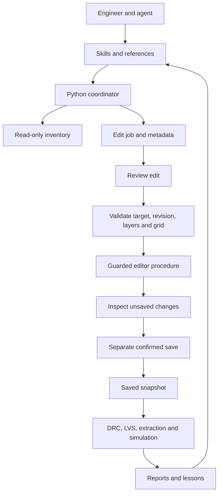

# Layout workflow and ownership

The reference has a live read path and a reviewed mutation path. In Cadence,
Python skillbridge uses a local socket/relay to reach Virtuoso's SKILL interpreter.
Virtuoso owns OA objects; Python holds handles. Our KLayout adapter will preserve
that operational contract using KLayout's database/API, without pretending to
implement OA or SKILL.

The bootstrap, file inventory, local search, manifest circuit runner, live GUI and
headless bridge, rectangle edits and separate snapshot saving are implemented.
See `docs/bridge.md`. The transport uses a private host-local Unix socket; GUI
database work runs on the Qt main thread. The original source file stays untouched.

- Mac: GUI, sources, small working set, local knowledge index.
- Linux worker: execution against a materialized local design/PDK snapshot.
- R2: object archives, not a live design database or execution host.
- Git: text sources, skills, testbenches, scripts, manifests and reviewed notes.

Select a process variant, devices, libraries, exact revision, DRC deck, extractor,
LVS setup, model corner and tool versions together. SKY130, GF180MCU and SG13G2
are candidates, not interchangeable libraries. Never invent numerical rules from
the process name.

## Evidence contract

Edit jobs record UUID, operation, exact target, input hash/revision,
parameters with units, layer map revision, approval state, procedure version,
before/after evidence, warnings and outputs. Saving is another job. Verification
reports additionally record deck/model hashes and commands. Missing evidence
stays unknown. Inspect state before retrying a timeout.

## Next milestones

1. Install one pinned tool-compatible PDK subset on a Linux worker.
2. Validate known-good and deliberately broken cells with its DRC/LVS decks.
3. Extend the validated scratch bridge with process device generators, vias and
   connectivity-aware operations only after choosing the PDK.
4. Verify the saved snapshot and compare post-layout simulation.
5. Add device placement and routing after the foundational checks work.
