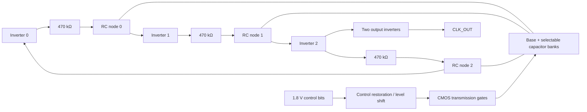

# RCO v0: switched-capacitor three-stage ring oscillator

This is the second circuit in the Chip Lab library. The requested nominal output
is **512 kHz** with **1.8 V digital controls**. SKY130A uses a 1.8 V oscillator
supply. GF180MCU D uses its existing 3.3 V device/supply setup and translates
the 1.8 V controls to that domain. These are schematic targets, not measured
silicon specifications.

## Function and topology

The circuit produces a continuous clock. Three inverting CMOS stages form a
negative-feedback ring. Each inverter drives the next gate through a resistor;
the gate node has a base capacitor and selectable capacitor branches to ground.
The extra RC delay sets a much lower frequency than an unloaded ring. A two-stage
CMOS output buffer isolates the ring from a 1 pF external test load.



Each capacitor switch is a parallel NMOS/PMOS transmission gate. A large
`MAIN` gate connects the full nine-bit bank to each RC node. It selects load;
it does not set a voltage threshold. The inverter trip point is set primarily
by its PMOS/NMOS strength ratio, supply, process, and temperature. A separate
threshold-control circuit would be a later design change.

| Component | v0 schematic value / role |
| --- | --- |
| Three CMOS inverters | Odd inversion count creates the oscillation loop. |
| Three series resistors | 470 kΩ nominal each; delay the next gate input. Physical resistor type and area remain to be selected per PDK. |
| Base capacitors | 0.5 pF on each RC node. |
| Nine-bit trimmer | Binary weights 5, 10, 20, 40, 80, 160, 320, 640, and 1280 fF on each stage. One control word drives all three stage banks. |
| Main switch | A larger PMOS/NMOS transmission gate per stage connects or disconnects the entire bank. |
| Control interface | Nine bits plus `MAIN`, all at 1.8 V. GF180 uses cross-coupled PMOS level shifters; SKY130 uses same-voltage control restoration. |
| Output buffers | Two cascaded CMOS inverters; 1 pF external load in the testbench. |

## Construction targets and scale

| Item | Current target or open decision |
| --- | --- |
| Nominal frequency | 512 kHz within ±1% after setting the trim code, at the modeled nominal corner and 25 °C. Wider temperature/process limits are not yet specified. |
| Digital interface | Nine trimmer bits plus `MAIN`, all referenced to 1.8 V. The trim code is static during this first measurement. |
| Core supply | 1.8 V on SKY130A; 3.3 V on GF180MCU D with a 1.8-to-3.3 V control level shifter. |
| Output | Buffered clock driving the 1 pF test load, with a modeled 10–90% supply swing. |
| Nominal duty cycle | Aim for 45–55% on the schematic prototype; measured values appear below. |
| Netlist scale | 130 MOS instances: 6 ring, 4 output buffer, 54 bank gates, 6 master gates, and 60 control-restorer/level-shifter devices. Thirty circuit capacitors (three base plus 27 binary branches) and one external test load. |
| Layout and power | PDK resistor/capacitor choice, die area, current, start-up over corners, and output drive specification need separate measurements and physical design. |

The 1 GΩ bleed elements in the netlist anchor disconnected capacitor nodes for
simulation. They are **testbench aids**, not specified physical resistors.

At code 100 (decimal) and `MAIN=1`, the nominal ideal load is 1.0 pF per stage.
For a trip point near half supply and resistor-dominated delay,
`t_stage ≈ R C ln(2)` and `f ≈ 1/(6 R C ln(2)) ≈ 512 kHz`.
The approximation omits switch on-resistance, input capacitance, device delay,
resistor/capacitor variation, leakage, slow-input short-circuit current, and
parasitic coupling. It predicts direction and a starting point, not a signoff
frequency. The control word must be settled before a frequency measurement;
dynamic switching can create glitches and phase jumps.
The ideal range from codes 0–511 is approximately 1.02 MHz to 168 kHz.
This does not promise 512 usable monotonic frequency steps: the 5 fF LSB is
comparable to possible switch and wiring parasitics, and the 1.28 pF MSB may
require a physically large capacitor. DNL/INL and usable resolution need PEX.

## First acceptance checks

1. Simulate PDK nominal models at 25 °C, steady controls, and both supplies.
2. Confirm start-up and at least ten output crossings after settling. The bench
   extends its stop time for high-capacitance codes, then checks the spread of
   the last nine periods is below 2%.
3. Measure period from late cycles; target 512 kHz for the nominal code.
4. Confirm adding capacitance lowers frequency and the buffered output swings
   close to the oscillator supply.
5. Record source/PDK hashes and simulator logs for both PDKs. A nominal pass is
   not a process-corner, mismatch, DRC, LVS, PEX, or silicon pass.

The first netlist and bench are built from `run.py`. The v1 PDK passive device
experiment and editable source are described below. Layout, DRC/LVS,
extracted RC, temperature/corner sweep, tuning range, and power remain open.

## Design log: decisions and observed adjustments

| Step | Engineering reason | What changed or was measured |
| --- | --- | --- |
| 1. Fix the topology | Three inversions provide regenerative oscillation. The requested 512 kHz is far below the intrinsic unloaded CMOS-ring rate, so each stage needs deliberate RC delay. | Used three PDK CMOS inverters, three 470 kΩ series resistors, and 0.5 pF base load per stage. |
| 2. Estimate the delay | `1/(2 × 3 × 512 kHz) = 325.5 ns` per inverter/RC stage. With a half-supply switching approximation, `R C ln 2` suggests about 1 pF at 470 kΩ. | Set a 5 fF binary unit and initially tested code 100, which makes 1.0 pF ideal per stage. |
| 3. Test the approximation | The real transistor models, finite trip point, switches, and buffers change the period. | Mac ngspice at 25 °C measured 674.6 kHz on SKY130A and 607.8 kHz on GF180MCU D at code 100. Both were above target. |
| 4. Increase capacitance | More switched capacitance increases each RC delay, so frequency should fall. | Code 164 measured 521.6 kHz on SKY130A; code 137 measured 521.0 kHz on GF180MCU D. |
| 5. Trim closer | Use the nine-bit word rather than changing the common resistor between processes. | Code **169** measured **511.112 kHz** on SKY130A (−0.174%); code **141** measured **511.046 kHz** on GF180MCU D (−0.186%). Both use 1.8 V digital controls. |
| 6. Test the master switch | If `MAIN` truly disconnects the bank, the same code should run much faster with it off. | With `MAIN=0`, SKY130A measured 1.373 MHz and GF180MCU D measured 1.273 MHz. |
| 7. Check the slow end | Large codes need a longer transient to count enough settled cycles. | GF180MCU D code 511 measured 209.95 kHz with 18 late rising edges. This checks one endpoint, not every trim step. |

The latest nominal runs measured 49.29% clock duty on SKY130A and 48.82% on
GF180MCU D. Their late-cycle period spread was below 0.002%. The waveform and
simulator-log hashes are recorded with the netlist and model-tree hashes.

These v0 measurements are from **native ngspice 47 on the user's arm64 Mac**, using
the pinned Volare PDK transistor models at their nominal corners. The caps and
resistors are ideal SPICE elements, so the frequency and 9-bit behavior have
not yet been validated with PDK passive devices or a physical layout. The GF180
oscillator uses 3.3 V while its control inputs are 1.8 V; the cross-coupled
level shifters translate their outputs to the oscillator domain. The two
different nominal codes are calibration observations, not process-wide trim
settings. See the ignored `runs/rco/<uuid>/` reports for full hashes and logs.

## v1 PDK passive experiment (native Mac)

The `--passives pdk` mode replaces the three ideal delay resistors and 30
circuit capacitors with named PDK devices. The 1 pF output load and 1 GΩ
bleeders are **testbench aids**. A single 5 fF MIM cell is not legal in GF180
option B because its minimum plate is 5 × 5 µm. The bank therefore builds
small effective weights from series MIMs and large weights from parallel MIMs.
SKY has 77 unit cells plus one base MIM per stage (234 total); GF has 61 units
plus one base MIM per stage (186 total). These are SPICE connections, not a
routed physical array.

| Process | Extractable resistor per stage | Extractable unit MIM | Base MIM | Closest measured code | Native nominal result |
| --- | --- | --- | --- | --- | --- |
| SKY130A | `res_xhigh_po_1p41`, 1.41 × 330 µm | `cap_mim_m3_2`, 4.5 × 4.5 µm | 15.7 × 15.7 µm | 146 | 512.863 kHz (+0.169%) |
| GF180MCU D | `ppolyf_u_1k`, 1 × 440 µm | option-B `cap_mim_2f0_m4m5_noshield`, 5 × 5 µm | 15.6 × 15.6 µm | 211 | 512.308 kHz (+0.060%) |

The first modeled choices were rejected during physical cross-checks. GF
Magic extracts the option-B MIM as 2.0 fF/µm², not the earlier 1.5 fF/µm²
model; it also supports the 1 kΩ/square high resistance poly PCell, not the
earlier 2 kΩ/square choice. On SKY, KLayout found `urpm.1a` on the original
0.35 µm poly resistor PCell even though Magic DRC reported zero. The wider
1.41 µm PCell passes both. The dashboard labels old runs as retired rather
than presenting their frequency as current physical-device evidence.

At the current binary-bank codes, opening `MAIN` gave 1.244 MHz on SKY and
1.265 MHz on GF. Nominal core-supply power from the late transient was
40.19 µW and 505.26 µW respectively; this excludes the separate digital
control sources. The GF resistor has nominal sheet geometry near 440 kΩ,
whereas SKY's is near 468 kΩ; the PDK models determine the actual behavior.
All results are from ngspice 47 on the user's arm64 Mac at 25 °C, with
per-run source, model, netlist, log, and waveform hashes in ignored `runs/rco/`.

### Editable Xschem circuit and testbench

`python3 -m examples.rco.generate_xschem` rebuilds the PDK-symbol sources at
`sky130/rco.sch`, `gf180/rco.sch`, and `gf180/rco_balanced.sch`. The generator
checks exported nets and capacitor widths of 65 NMOS, 65 PMOS, three
resistors, and 234 SKY or 186 GF MIM cells against the corresponding bank
model. Native Xschem opens these named-net drawings
through the dashboard. The **Simulate editable Xschem source** option exports
the current `.sch`, inserts its device lines into the same stimulus and
measurement bench, and records the schematic and export hashes. It measured
512.863 kHz on SKY at code 146 and 512.310 kHz on GF at code 211, within
2 Hz of the generated-netlist runs. The balanced GF source measured
511.490 kHz at code 117, within 1 Hz of its generated-netlist run. These
are schematic translation checks, not physical LVS.

### Isolated physical passive audit

`python3 examples/rco/validate_passives.py sky130` and the `gf180` form draw
selected MIM and high resistance poly PCells, export GDS, extract SPICE, and run
Magic plus native KLayout DRC. Both current test cells had **zero Magic DRC
errors and zero KLayout DRC items**. Magic extracted the same passive names
and dimensions listed above. Each run has a hashed report under ignored
`runs/rco/passive_probe/<process>/<uuid>/`. The RCO page can open this
isolated GDS and its marker database in KLayout. These checks say nothing
about the full oscillator's wiring, DRC, LVS, or PEX.

### Nine-bit trim hole and next physical stage

The GF binary bank is **not monotonic** in measured transient tests. The
frequency rose when advancing 207→208, 211→212, 223→224, and 255→256.
For example, 211 measured 512.308 kHz while 212 measured 512.794 kHz. The
series MIM weights, switch parasitics, and capacitance voltage dependence
need a bank redesign or calibrated code map before claiming 512 ordered steps.
In a bounded native transient sweep of **all codes 200–225**, six of 25
adjacent steps reversed direction (203→204, 207→208, 211→212, 215→216,
219→220, and 223→224). Code 211 was the closest point in that range:
512.308 kHz, +0.060% relative to target. The sweep saved every netlist,
waveform, log, and report under ignored `runs/rco/sweeps/`; it checks nominal
transient behavior only and is not a full trim characterization.
A `--bank-style guarded` experiment progressively enlarged higher GF MIMs.
It repaired those sampled carry transitions, but made a 37.59 kHz gap between
codes 127 (518.855 kHz) and 128 (481.266 kHz), so it is not the baseline.
The dashboard keeps binary and guarded runs separate; a full 512-code transient sweep,
DNL/INL, temperature/corner checks, and charge-state testing remain open.

A full **small-signal AC bank sweep** at a fixed mid-supply bias found
127 reversed effective-capacitance steps out of 511 on GF's binary bank.
At codes 211→212, its effective capacitance fell from 1318.764 to
1316.446 fF; the oscillator frequency rose at the same transition. The
progressive guard still had 112 reversed AC steps, despite fixing a few
sampled transient carries. These AC runs use the PDK MOS/MIM models and
control restoration but exclude the oscillating loop, resistor, charge
history, and layout. The dashboard plots all 512 GF points and lets a click
load a physical trim code. The native Mac reports and per-code decks are in
ignored `runs/rco/bank_ac/gf180/<uuid>/`.

### Balanced GF bank candidate

The binary and guarded AC sweeps let us estimate each bit's fixed-bias
contribution as `ΔCᵢ(w) ≈ pᵢ + aᵢ(w / 5 µm)²`. We chose the smallest
0.1 µm width that put each bit about 3 fF above the sum of all lower
bits. The GF unit-cell widths for bits 0–8 are **5.0, 5.0, 6.0, 6.5,
6.7, 6.8, 6.9, 7.0, 7.0 µm**. This changes unit-cell area while keeping
the series/parallel topology and 1.8 V control interface.

The complete **512-code GF AC bank sweep had zero reversed capacitance
steps** at 1.65 V DC bias and 512 kHz AC. Its smallest measured binary
carry margin was 3.392 fF. A native transient sweep of codes **112–120**
had zero frequency reversals in its eight adjacent pairs. Code **117
measured 511.490 kHz (−0.100%)** at 25 °C with typical PDK models and
about **504.45 µW** core-supply power. These are promising electrical
checks, not proof of monotonic transient behavior across all 512 codes
or across process, voltage, and temperature. The dashboard labels this
candidate **Balanced GF experiment**, with a separate editable Xschem source.
With `MAIN=0`, that Xschem source measured **1.265 MHz**, confirming the
master switch still disconnects the bank in the updated variant.

The isolated GF physical probe now contains both 5 × 5 µm and 7 × 7 µm
MIM PCells plus the poly resistor. Magic extraction recognized both MIM
dimensions and the resistor; Magic and native KLayout each reported zero
DRC errors/items. The intermediate widths were also instantiated in the
unrouted RCO placement below; routing, LVS, and PEX remain unverified.

### Sampled process, voltage, and temperature checks

Native Mac ngspice runs searched trim codes at two educational stress
corners per open PDK. These are schematic simulations with modeled devices
and ideal wires. Each search sampled 13–14 codes, so it can demonstrate
target reachability along that path but cannot establish 512-code
monotonicity or the globally best code.

| PDK and corner | VDD and temperature | Best sampled code | Frequency | Error from 512 kHz |
| --- | --- | ---: | ---: | ---: |
| SKY130A fast `ff_ll` | 1.89 V, 0 °C | 175 | 511.804 kHz | −0.038% |
| SKY130A slow `ss_hh` | 1.71 V, 85 °C | 125 | 511.678 kHz | −0.063% |
| GF180MCU D fast | 3.465 V, 0 °C | 183 | 512.036 kHz | +0.007% |
| GF180MCU D slow | 3.135 V, 85 °C | 76 | 513.300 kHz | +0.254% |

The reports are under `runs/rco/corner_trim/` and appear in the Chip Lab
RCO corner panel. No mismatch, startup distribution, post-layout R/C,
process qualification, or silicon correlation is implied.

SKY AC spot checks at codes 146 and 147 gave 1346.829 and 1355.673 fF.
A full SKY AC sweep is deferred: the installed SKY model took about 13–20 s
per code on this 8 GB Mac, while its two native transient checks already
confirm the local frequency direction. The 512-code AC sweep would take
roughly an hour at two concurrent workers.

### Unrouted RCO placement and DRC checkpoint

`place.py` instantiates every schematic PDK device as a Magic PCell, exports
GDS, and records a device-origin manifest. `validate_placement.py` checks
that exact GDS with worker Magic and native Mac KLayout full PDK decks. The
latest hashed placement reports are under ignored `runs/rco/placement/`.

| Process | PDK devices | Magic DRC | Native KLayout DRC | GDS extent |
| --- | ---: | ---: | ---: | ---: |
| SKY130A binary | 367: 130 MOS, 234 MIM, 3 resistors | 0 errors | 0 items | ~1006 × 1007 µm |
| GF180MCU D balanced | 319: 130 MOS, 186 MIM, 3 resistors | 0 errors | 0 items | ~1008 × 1008 µm |

The first GF placement exposed 65 Nwell-tap and 65 substrate-tap distance
violations in the native KLayout deck. Nearby local tap shapes cleared those
distance rules. The contacts are **not connected to power**. The first SKY
placement exposed 240 Magic errors and 14 unique KLayout metal spacing
markers from default MOS gate-contact shapes. Removing top and bottom gate
contacts from these placement PCells cleared that geometry; legal gate
contacts must be added during routing. These corrections explain how the
DRC-clear *placement* was reached, but they do not establish a connected
functional circuit.

The RC-node instance origins are spread widely: `n0` spans 627 × 795 µm,
`n1` 515 × 860 µm, and `n2` 627 × 860 µm in both floorplans. These are
bounding spans of placed **device origins**, not measured wire lengths.
They identify a layout risk: long routes can add series resistance and
wire-to-substrate or coupled capacitance, changing delay and trim weights.
SkyWater's published RCX notes say coupling from nearby routing to precision
poly resistors is not extracted, so the SKY resistor neighborhood needs a
keep-out and a separate modeling caveat even after routing.
The first routed iteration should cluster each resistor, inverter input,
switches, and its capacitor bank. A second iteration can compare tighter
placement with the original, using actual extracted R/C and waveforms.

### First-year circuit reading guide

An RC node changes voltage because the capacitor stores charge, `Q = C V`.
Its current is `I_C = C dV/dt`; the resistor limits the charge rate. For an
ideal resistor charging a capacitor from zero toward a step at `VDD`, the
voltage is `VDD(1 − exp(−t/RC))`. The half-supply crossing occurs at
`t = R C ln(2)`. A 512 kHz three-stage ring needs about
`1/(6 × 512 kHz) = 325.5 ns` average delay per stage. The formula is a
starting estimate; MOS trip points, switch resistance, input capacitance,
and capacitor voltage dependence modify the modeled waveform.

In Chip Lab, select **Circuit library → Nine-bit RCO**. Toggle RC0, RC1,
RC2, and CLK_OUT on the voltage plot. The new plot beneath it shows current
drawn from the core supply, positive when the source delivers current. Move
over either plot to read time, four voltages, local RC0 slope, approximate
half-supply reference (the yellow line is not a measured MOS trip point), and
current. Click twice to measure a time interval,
RC0 voltage change, mean current, and supply energy `∫VDD I(t)dt` from the
displayed samples. The range form also measures how long a selected voltage
or current stayed inside a band during a chosen time window. Supply current
includes all core devices; it is not one
capacitor's current. The saved PDK simulations on the native arm64 Mac are
schematic-level, with ideal wiring, not post-layout measurements.

The full RCO has **no routed GDS, electrical RCO LVS, or RCO PEX yet**. Zero
DRC items apply only to the unrouted placement geometry. The inverter's
previous physical checks and the isolated passive-cell checks cannot be
used as RCO signoff. Connecting the devices, verifying power/body ties,
running DRC and LVS again, and extracting parasitics are the next physical
steps before a post-layout 512 kHz claim.

### Why KLayout shows polygons instead of editable PCells

The placement was generated with **Magic** PCells. GDS preserves the drawn
polygons and cell hierarchy, but not Magic's PCell generator and parameters.
KLayout can store its own PCell context in a GDS it writes; this particular
Magic export contains no such KLayout context.
Native KLayout readback found 367 SKY or 319 GF top-level instances, yet all
11 SKY or 17 GF imported cells return `is_pcell_variant() == false`. The GDS
is therefore hierarchical but static in KLayout. Selecting a shape cannot
open a KLayout PCell parameter dialog for it. The dashboard's placement
inspector shows the original device name, width/length parameters, and
schematic-intended terminals from the hashed generation manifest.

The installed open PDKs include *separate* KLayout PCell generator macros.
The Mac's global KLayout profile has no PDK macros (`~/.klayout/pymacros` is
empty). The RCO dashboard now launches the GF placement with the installed
`gf180mcu_klayoutapi` library loaded for that session. Its native KLayout
Python runtime registered NMOS, PMOS, MIM, and poly resistor PCells in a
headless check. A scratch-layout probe generated true editable NMOS and MIM
variants (`is_pcell_variant() == true`) with nonempty geometry. Press `I` in
an edit-mode **scratch layout** to explore those
new editable instances. This does not turn the Magic-exported RCO GDS into
parametric cells, nor substitute the GF KLayout generator for its validated
Magic device geometry. The SKY generator asks for `gdsfactory`, which is not
installed, so its RCO placement remains a static-cell inspection for now.

KLayout's default field keys on this Mac profile have no custom overrides:
`F2` (or `Fn+F2` on a Mac keyboard using media keys) fits the layout; `C` and `L` show Cells and Layers; `-`/`+` change visible
hierarchy; `S` selects; `Q` opens properties; `D` descends and `A` ascends;
`R` measures; `I` starts instance placement in edit mode; `Esc` cancels.
The dashboard's KLayout button launches edit mode (`-e`). First fit with
`F2`, show Cells with `C`, reduce hierarchy with `-`, select a device box,
then press `Q` or `D`. This teaches the cell hierarchy without implying
those static device cells have editable parameters. On this Mac, KLayout →
Preferences → Application → Customize Menu lets you inspect or change shortcuts.
To change a device width in the current flow, edit the circuit source and
regenerate its Magic placement, then rerun DRC. Changing a static polygon in
KLayout would diverge from the schematic and invalidate the recorded hashes.

## Reproduce the current Mac checks

Run these from the repository root. Each command writes a new private,
ignored report under `runs/rco/` and prints its location. The full GF AC bank
sweep runs 512 PDK simulations; the bounded transient sweep runs 26.

```sh
python3 examples/rco/run.py sky130 146 --passives pdk --xschem
python3 examples/rco/run.py gf180 211 --passives pdk --xschem
python3 examples/rco/validate_passives.py sky130
python3 examples/rco/validate_passives.py gf180
python3 examples/rco/sweep_trim.py gf180 200 225 --workers 2
python3 examples/rco/analyze_bank.py gf180 --bank-style binary --workers 2
python3 examples/rco/sweep_trim.py gf180 112 120 --bank-style balanced --workers 2
python3 examples/rco/analyze_bank.py gf180 --bank-style balanced --workers 2
python3 -m examples.rco.place sky130
.venv/bin/python -m examples.rco.validate_placement sky130
python3 -m examples.rco.place gf180
.venv/bin/python -m examples.rco.validate_placement gf180
```

In Chip Lab, choose **Nine-bit RCO** from the circuit menu, then switch
between SKY130A and GF180MCU D. The saved-run selector loads measured
waveforms and the exact SPICE testbench. The bank graph shows the AC
diagnostic; red segments identify reversed capacitance steps. The graph is
centered on the selected code and can be expanded to all 512 codes.
