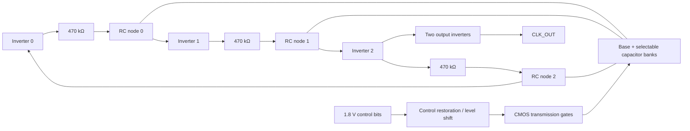

# RCO v0: switched-capacitor three-stage ring oscillator

This is the second circuit in the Chip Lab library. The requested nominal output
is **512 kHz** with **1.8 V digital controls**. SKY130A uses a 1.8 V oscillator
supply. GF180MCU D uses its existing 3.3 V device/supply setup and translates
the 1.8 V controls to that domain. These are schematic targets, not measured
silicon specifications.

## Function and topology

The circuit produces a continuous clock. Three inverting CMOS stages form a
negative-feedback ring. Each inverter drives the next gate through a resistor;
the gate node has a base capacitor and selectable capacitor branches to ground.
The extra RC delay sets a much lower frequency than an unloaded ring. A two-stage
CMOS output buffer isolates the ring from a 1 pF external test load.

Each capacitor switch is a parallel NMOS/PMOS transmission gate. A large
`MAIN` gate connects the full nine-bit bank to each RC node. It selects load;
it does not set a voltage threshold. The inverter trip point is set primarily
by its PMOS/NMOS strength ratio, supply, process, and temperature. A separate
threshold-control circuit would be a later design change.

| Component | v0 schematic value / role |
| --- | --- |
| Three CMOS inverters | Odd inversion count creates the oscillation loop. |
| Three series resistors | 470 kΩ nominal each; delay the next gate input. Physical resistor type and area remain to be selected per PDK. |
| Base capacitors | 0.5 pF on each RC node. |
| Nine-bit trimmer | Binary weights 5, 10, 20, 40, 80, 160, 320, 640, and 1280 fF on each stage. One control word drives all three stage banks. |
| Main switch | A larger PMOS/NMOS transmission gate per stage connects or disconnects the entire bank. |
| Control interface | Nine bits plus `MAIN`, all at 1.8 V. GF180 uses cross-coupled PMOS level shifters; SKY130 uses same-voltage control restoration. |
| Output buffers | Two cascaded CMOS inverters; 1 pF external load in the testbench. |

## Construction targets and scale

| Item | Current target or open decision |
| --- | --- |
| Nominal frequency | 512 kHz within ±1% after setting the trim code, at the modeled nominal corner and 25 °C. Wider temperature/process limits are not yet specified. |
| Digital interface | Nine trimmer bits plus `MAIN`, all referenced to 1.8 V. The trim code is static during this first measurement. |
| Core supply | 1.8 V on SKY130A; 3.3 V on GF180MCU D with a 1.8-to-3.3 V control level shifter. |
| Output | Buffered clock driving the 1 pF test load, with a modeled 10–90% supply swing. |
| Nominal duty cycle | Aim for 45–55% on the schematic prototype; measured values appear below. |
| Netlist scale | 130 MOS instances: 6 ring, 4 output buffer, 54 bank gates, 6 master gates, and 60 control-restorer/level-shifter devices. Thirty circuit capacitors (three base plus 27 binary branches) and one external test load. |
| Layout and power | PDK resistor/capacitor choice, die area, current, start-up over corners, and output drive specification need separate measurements and physical design. |

The 1 GΩ bleed elements in the netlist anchor disconnected capacitor nodes for
simulation. They are **testbench aids**, not specified physical resistors.

At code 100 (decimal) and `MAIN=1`, the nominal ideal load is 1.0 pF per stage.
For a trip point near half supply and resistor-dominated delay,
`t_stage ≈ R C ln(2)` and `f ≈ 1/(6 R C ln(2)) ≈ 512 kHz`.
The approximation omits switch on-resistance, input capacitance, device delay,
resistor/capacitor variation, leakage, slow-input short-circuit current, and
parasitic coupling. It predicts direction and a starting point, not a signoff
frequency. The control word must be settled before a frequency measurement;
dynamic switching can create glitches and phase jumps.
The ideal range from codes 0–511 is approximately 1.02 MHz to 168 kHz.
This does not promise 512 usable monotonic frequency steps: the 5 fF LSB is
comparable to possible switch and wiring parasitics, and the 1.28 pF MSB may
require a physically large capacitor. DNL/INL and usable resolution need PEX.

## First acceptance checks

1. Simulate PDK nominal models at 25 °C, steady controls, and both supplies.
2. Confirm start-up and at least ten output crossings after settling. The bench
   extends its stop time for high-capacitance codes, then checks the spread of
   the last nine periods is below 2%.
3. Measure period from late cycles; target 512 kHz for the nominal code.
4. Confirm adding capacitance lowers frequency and the buffered output swings
   close to the oscillator supply.
5. Record source/PDK hashes and simulator logs for both PDKs. A nominal pass is
   not a process-corner, mismatch, DRC, LVS, PEX, or silicon pass.

The first netlist and bench are built from `run.py`. Layout, physical capacitor
and resistor selection, DRC/LVS, extracted RC, temperature/corner sweep, tuning
range, and power remain open for this circuit.

## Design log: decisions and observed adjustments

| Step | Engineering reason | What changed or was measured |
| --- | --- | --- |
| 1. Fix the topology | Three inversions provide regenerative oscillation. The requested 512 kHz is far below the intrinsic unloaded CMOS-ring rate, so each stage needs deliberate RC delay. | Used three PDK CMOS inverters, three 470 kΩ series resistors, and 0.5 pF base load per stage. |
| 2. Estimate the delay | `1/(2 × 3 × 512 kHz) = 325.5 ns` per inverter/RC stage. With a half-supply switching approximation, `R C ln 2` suggests about 1 pF at 470 kΩ. | Set a 5 fF binary unit and initially tested code 100, which makes 1.0 pF ideal per stage. |
| 3. Test the approximation | The real transistor models, finite trip point, switches, and buffers change the period. | Mac ngspice at 25 °C measured 674.6 kHz on SKY130A and 607.8 kHz on GF180MCU D at code 100. Both were above target. |
| 4. Increase capacitance | More switched capacitance increases each RC delay, so frequency should fall. | Code 164 measured 521.6 kHz on SKY130A; code 137 measured 521.0 kHz on GF180MCU D. |
| 5. Trim closer | Use the nine-bit word rather than changing the common resistor between processes. | Code **169** measured **511.112 kHz** on SKY130A (−0.174%); code **141** measured **511.046 kHz** on GF180MCU D (−0.186%). Both use 1.8 V digital controls. |
| 6. Test the master switch | If `MAIN` truly disconnects the bank, the same code should run much faster with it off. | With `MAIN=0`, SKY130A measured 1.373 MHz and GF180MCU D measured 1.273 MHz. |
| 7. Check the slow end | Large codes need a longer transient to count enough settled cycles. | GF180MCU D code 511 measured 209.95 kHz with 18 late rising edges. This checks one endpoint, not every trim step. |

The latest nominal runs measured 49.29% clock duty on SKY130A and 48.82% on
GF180MCU D. Their late-cycle period spread was below 0.002%. The waveform and
simulator-log hashes are recorded with the netlist and model-tree hashes.

These measurements are from **native ngspice 47 on the user's arm64 Mac**, using
the pinned Volare PDK transistor models at their nominal corners. The caps and
resistors are ideal SPICE elements, so the frequency and 9-bit behavior have
not yet been validated with PDK passive devices or a physical layout. The GF180
oscillator uses 3.3 V while its control inputs are 1.8 V; the cross-coupled
level shifters translate their outputs to the oscillator domain. The two
different nominal codes are calibration observations, not process-wide trim
settings. See the ignored `runs/rco/<uuid>/` reports for full hashes and logs.
