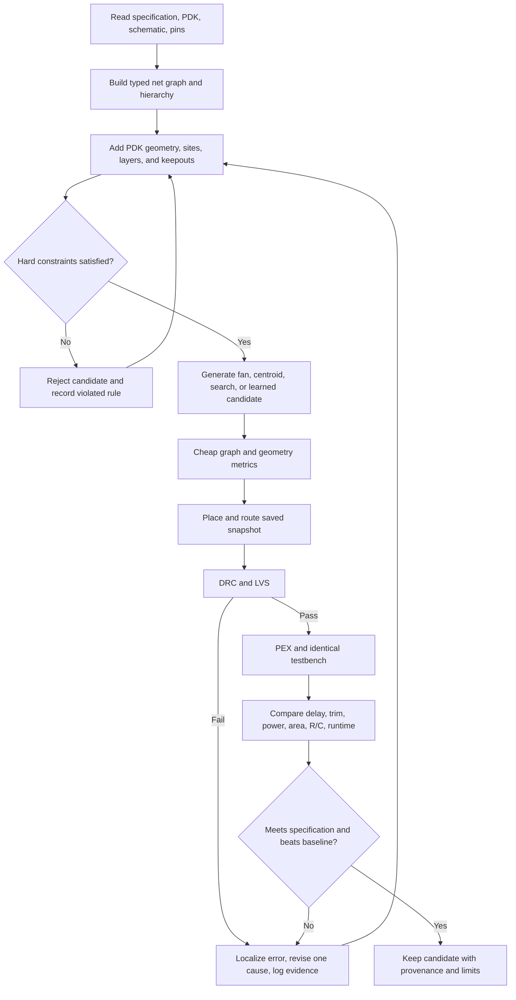

# Graphs, grids, and learning for RCO floorplanning

Research and first Mac probe, 2026-11-14. This is a study plan for the
open-PDK lab, not a claim that an AI model has been trained or that the full
capacitor bank has been routed.

After the engineer's correction, [the full-bank paper digest](routability-paper-digest.md)
separates the complete nine-bit placement from the isolated four-MIM routing
coupon and records the RouteNet/Circuit GNN methods and reproduction limits.

## What must be represented

The schematic is a **typed, terminal-aware hypergraph**. Devices and nets are
separate objects: a MOS has gate, drain, source, and body terminal edges; a MIM
has two plate terminals; one net can attach to many terminals. Device and net
IDs, bit and stage membership, series order, supply domain, and control state
must survive parsing. A plain device-to-device edge can hide a shared net or
erase which MIM plate is connected. The original SPICE and LVS result remain
the authority for connectivity. Circuit-netlist research uses directed
hypergraphs for this reason [DE-HNN](https://arxiv.org/abs/2404.00477);
[Circuit GNN](https://proceedings.neurips.cc/paper_files/paper/2022/hash/7fa548155f40c014372146be387c4f6a-Abstract-Conference.html)
combines topology and geometry in a heterogeneous graph.

The layout needs **several related structures**, not one image:

| Structure | What it answers | What it misses alone |
| --- | --- | --- |
| Hierarchy tree | Which PCells, branches, stages, and blocks belong together | Electrical loops and shared nets |
| Terminal/net hypergraph | Which plates and pins must connect | Distance, obstacles, coupling |
| Spatial index (site hash, kd-tree, R-tree) | Which sites or polygons are nearby | Whether they share a net or may legally connect |
| Layered routing graph | Legal candidate moves between `(x,y,layer)` vertices; vias are edges | Analog performance without extraction |
| Coupling graph | Nearby aggressor/victim segments after routing | The complete field solution |
| Grid image with feature channels | Density, obstacles, wire demand, and local hotspots | Exact net and terminal identity unless explicitly encoded |
| Decision tree / rule list | Auditable `if condition → action → check` choices | New physics or PDK rules it was never given |

The spatial index should index actual PDK polygons or site centers, keyed by
cell, layer, net, and process. An R-tree filters geometry by bounding boxes;
it does not prove DRC clearance. [Shapely STRtree documentation](https://shapely.readthedocs.io/en/stable/strtree.html)
and [SciPy cKDTree documentation](https://docs.scipy.org/doc/scipy/reference/generated/scipy.spatial.cKDTree.html)
describe the two index types. The full net/layout representation should retain
both terminal connectivity and geometry so a four-unit **series** chain is not
mistaken for four parallel capacitors.

## Which method is useful where

- **Rules and exact graph checks first:** Count units, test per-bit site
  connectivity, preserve series order, and reject overlap or illegal grid
  assignments. These are cheap, inspectable constraints.
- **Graph search for a legal two-terminal route:** Model width, layer, via,
  obstacles, and penalties as nonnegative edge costs. Dijkstra gives a
  shortest path for those costs; A* can visit fewer vertices with an
  admissible distance lower bound. A* does not certify DRC or optimize all
  nets at once. [NetworkX A* documentation](https://networkx.org/documentation/stable/reference/algorithms/generated/networkx.algorithms.shortest_paths.astar.astar_path.html)
  explains the optimality condition.
- **CNN for spatial prediction:** A rasterized layout can help predict
  congestion or DRC hotspots. Published RouteNet work evaluates this on
  mixed-size digital benchmarks; it is evidence for a candidate predictor,
  not for our small analog RCO. [RouteNet original research](https://research.nvidia.com/index.php/publication/2018-11_routenet-routability-prediction-mixed-size-designs-using-convolutional-neural).
  [CircuitNet](https://circuitnet.github.io/intro/overview.html) publishes
  image and graph features with labels for congestion, DRC, IR drop, and
  delay, illustrating how many paired features and ground-truth labels are
  needed.
- **GNN for topology-aware prediction:** Message passing can use net type,
  terminal role, device size, location, and route features to estimate
  congestion or delay and rank candidates. Published
  [RoutePlacer](https://doi.org/10.1145/3637528.3671895) and
  [TransPlace](https://arxiv.org/abs/2501.05667) report benefits on their
  placement benchmarks. Their quality figures cannot be transferred to our
  PDKs or four-MIM sample. Long-range dependencies can be difficult for
  message-passing GNNs ([original bottleneck study](https://arxiv.org/abs/2006.05205)).

Neither learned model replaces PDK DRC, LVS, extraction, or circuit simulation.
For now, the small number of routed RCO examples supports **no honest
trained-model accuracy estimate**. A GNN or CNN becomes an experiment once we
have diverse, labeled layouts and a held-out evaluation set.

## Big O, in ordinary terms

`n` is the number of devices or sites; `V` and `E` are vertices and edges of
a route graph. `O(...)` describes how work can grow with input size, not the
runtime of a particular Mac run. Constant overhead, geometry density, and
PDK checks still matter.

| Question or algorithm | Work scale | Practical interpretation |
| --- | --- | --- |
| Scan all `n` sites for nearest | `O(n)` per query | Often adequate for 61–77 MIM units |
| Balanced 2-D kd-tree nearest | Often near `O(log n)` per query after indexing; worst case can approach `O(n)` | Good for many repeated point queries, not a legal-route solver |
| Pairwise adjacency scan | `O(n²)` worst case | Tests every possible neighbor repeatedly |
| Four-neighbor site hash / DFS | Expected `O(n)` time and `O(n)` memory | Appropriate for our fixed site grid |
| BFS on an unweighted route graph | `O(V+E)` | Fewest grid edges, regardless of electrical cost |
| Binary-heap Dijkstra | `O((V+E) log V)` | Minimum sum of nonnegative edge costs; [MIT notes](https://ocw.mit.edu/courses/6-006-introduction-to-algorithms-spring-2020/ec187276db0faaa047d655979a44de7f_MIT6_006S20_r13.pdf) |
| A* with admissible heuristic | Dijkstra-like worst-case growth; search may expand fewer vertices | `log n` is **not** the complexity of finding a route |
| Enumerate all orders of `n` distinct devices | `n!` | Exhaustive placement quickly becomes impractical; use constraints and search |

Two-terminal shortest path is much simpler than multi-terminal, multi-net
placement and routing with spacing, vias, congestion, coupling, and timing.
For example, even ideal rectilinear Steiner routing is an NP-hard model
([GAT-Steiner research introduction](https://arxiv.org/abs/2407.01440)).
We therefore compare candidate generators under an equal verification budget
instead of expecting a single nearest-neighbor query to solve the bank.

## First native-Mac comparison on our saved plans

Run `uv run --frozen --extra layout python -m examples.rco.representation_probe`.
The [saved JSON report](representation-probe-2026-11-14.json) records
the source and floorplan-data hashes, host, per-bit component counts, and
timings. It scores the saved **logical SVG tiles**, not GDS or metal
connectivity. Site adjacency means neighboring tile centers on the drawing.

| Fan revision | SKY split bits / extra components | GF split bits / extra components | Staggered x grid? |
| --- | ---: | ---: | --- |
| 1 · Original mirrored | 8 / 24 | 8 / 18 | No |
| 2 · Compact | 8 / 27 | 8 / 25 | Yes |
| 3 · Uniform | 7 / 25 | 7 / 21 | No |
| 4 · Connected groups | **0 / 0** | **0 / 0** | No |

The same component counts came from a pairwise scan and a four-neighbor hash
walk. On this Mac, their median time over five batches of 200 passes across
eight small fan panels was **0.0526 ms** and **0.0366 ms per panel**,
respectively. That small difference is a Python microbenchmark, not a
prediction of whole-chip speed or AI learning.

For the actual four-MIM **series order** in each PDK, the fan and connected
centered map need at least three adjacent site hops, or **42 µm** of
center-to-center Manhattan travel. The exact-centroid reference puts the
four ordered units at `(2,3) → (2,13) → (2,1) → (2,15)` and requires at least
**504 µm** of Manhattan travel across its three series links. That is a
**12× geometric lower-bound ratio**, with no obstruction, via, plate-terminal,
or coupling cost. It demonstrates why a visually symmetric map may be poor
for this electrical topology; it does **not** measure extracted R/C, delay,
or oscillator frequency. An exact-centroid option may still win a different
matching objective.

This is a retrospective, **human-guided rule-compliance curve**: the engineer
changed the requirements and corrected our proposals across revisions. It is
not a machine-learning training curve. We will preserve the earlier drafts
and evaluate future methods against one fixed set of requirements.

## Decision and experiment loop

For each proposal, the reviewable decision record will list **observations,
constraints, candidate choices, predicted physical effect, selected action,
tool evidence, discrepancy, and correction**. This exposes decisions and
tests without pretending to capture an AI's private internal reasoning.

## Fair comparison and learning curve to collect next

1. Fix PDK revision, source netlist, supply, trim word, temperature/corners,
   site grid, DRC/LVS decks, and testbench for each comparison. Use the same
   computer or record hardware separately. Compare within each PDK first.
2. For rule-based fan, connected centroid, exact centroid, graph search, and
   later GNN/CNN candidate generators, record candidate count, expanded
   states, CPU/wall time, peak memory, route length, vias, DRC/LVS status,
   extracted per-bit R/C, and waveform/trim metrics. Failed runs stay in the
   dataset; they are not silently discarded.
3. Score quality by **verified post-layout behavior**, with the 512 kHz trim
   target, phase/skew, monotonic steps, power, and area reported separately.
   A proxy score never stands in for PEX or simulation.
4. Once there are enough diverse labeled examples, train predictors on one
   set of circuit/layout families and evaluate on held-out families or PDK
   contexts. Do not put near-duplicate route variants in both training and
   test. Plot error and verified design quality against labeled-example count
   and compute cost. Include a simple rule-based baseline.
5. After each engineer correction, add a dated lab-book entry with the prior
   prediction, observed failure, revised rule, and next test. Do not rewrite
   an earlier hypothesis as though it had already been correct.
