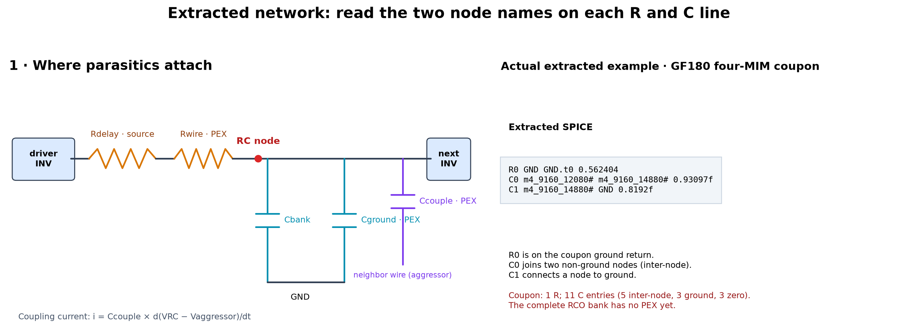
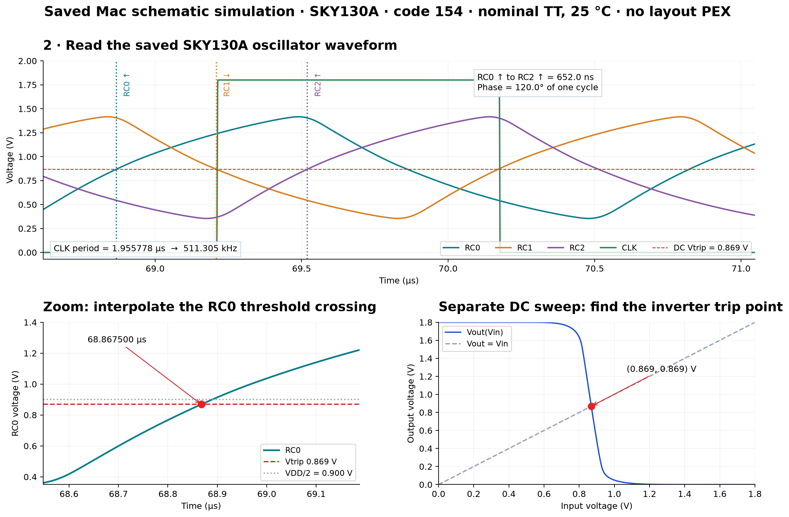
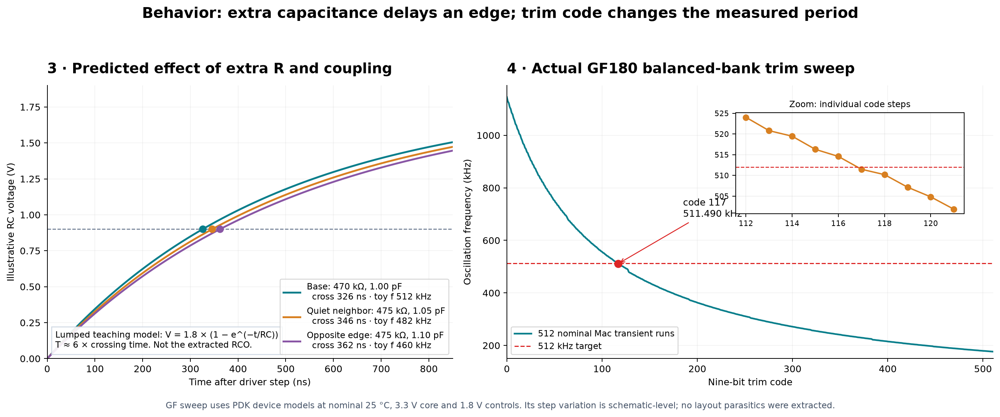

# Read RCO parasitics on a waveform

This lesson uses three different kinds of evidence. Keep them separate:

| Figure | Source | What it establishes |
| --- | --- | --- |
| 1 | Native Mac GF180MCU D **isolated four-MIM coupon** RCX | Example SPICE resistor, coupling capacitor, and ground capacitor entries; not a full RCO extraction |
| 2 | Native Mac SKY130A code-154 **Xschem/ngspice schematic** waveform and a separate DC sweep of its INV1 MOS pair | Nominal RC waveform, DC inverter trip reference, period and phase; no layout parasitics |
| 3 left | Analytic lumped RC teaching model | Predicted direction of extra R and C; not an extracted circuit result |
| 3 right | Native Mac GF180MCU D balanced-bank 512-code **schematic** sweep | Nominal trim-frequency behavior; no layout parasitics |

## 1. Find resistance and capacitance in the extracted network



A resistor line has two node names and an ohmic value. A capacitor line has
two node names and a farad value. A capacitor connected to `GND` is a
ground capacitance; one joining two different signal nodes is coupling.
For the real GF coupon, `R0 GND GND.t0 0.562404` is a **ground-return**
resistance. `C0` joins two non-ground M4 nodes with 0.93097 fF; `C1`
joins an M4 node to ground with 0.8192 fF. The coupon RCX reported one
resolved resistor and eleven **C entries**: five nonzero inter-node, three
nonzero to ground, and three zero-value entries. Its old report field calls
all eleven “coupling,” which is too broad. Its R0 is not evidence of a
signal-path wire resistor in the full RCO. An inter-node capacitor loads
the difference between its two node voltages; inspect the nets before
calling one a neighboring aggressor.

The physical coupling current is
`i_couple = C_couple × d(V_RC − V_aggressor)/dt`. When the neighboring wire
is quiet, its coupling looks approximately like capacitance to ground. When
it switches in the opposite direction, the voltage across the coupling
capacitor changes faster and the RC node can be slowed or disturbed.
Switching together can reduce that differential change. These effects are
time-dependent, so a single fixed “effective C” is only an approximation.

## 2. Locate an inverter threshold crossing



The separate nominal 25 °C DC sweep of the same SKY130A INV1 MOS geometry
gave `Vout = Vin` at **0.868752 V**. This is a useful static trip reference.
The actual dynamic decision can shift with input slew, loading, supply and
process. The common `VDD/2 = 0.900 V` reference is 31.248 mV higher here.

To read the RC0 rising crossing, take the two saved waveform samples that
surround 0.868752 V:

| Time | RC0 voltage |
| ---: | ---: |
| 68.8629926 µs | 0.862256788 V |
| 68.8679926 µs | 0.869461827 V |

Linear interpolation gives
`t_cross = t_a + (Vtrip−V_a)/(V_b−V_a) × (t_b−t_a)` =
**68.867500 µs**. The 0.900 V half-supply crossing occurs later, at
68.889580 µs. On the plot, watch for a rising or falling RC trace crossing
the red trip line, then inspect when the next stage and buffered clock move.

## 3. Turn waveform spacing into frequency and phase

The saved SKY clock has a mean late-cycle period of **1.955778 µs**, so
`f = 1/T = 511.305 kHz`. On the selected cycle, RC0 rises through the
DC trip reference at 68.867500 µs; RC1 falls through it at 69.208670 µs;
RC2 rises through it at 69.519487 µs. RC0-to-RC2 is 0.651987 µs.
Its same-polarity phase offset is
`360° × 0.651987 / 1.955778 = 120.01°`.
For opposite-polarity edges, state both the edge direction and time offset;
an RC0 rise to RC1 fall is 341.170 ns.

## 4. Predict delay and read trim steps



For a teaching step response, `V_RC(t)=VDD[1−exp(−t/RC)]` and a half-supply
crossing is `t_50=RC ln 2`. The left plot holds VDD at 1.8 V. A 470 kΩ,
1.00 pF example crosses in 326 ns. Adding 5 kΩ and 50 fF moves it to
346 ns; the opposite-edge illustration uses another 50 fF effective load
and crosses at 362 ns. The rough symmetric three-stage estimate
`f≈1/(6t_50)` moves from 512 to 482 to 460 kHz. These are **model
predictions**, not PEX measurements of the RCO.

The right plot is actual nominal GF180MCU D schematic simulation, with a
3.3 V core and 1.8 V controls. Code 117 gives **511.490 kHz**. Code
116→117 changes frequency by **−3.101 kHz**; 117→118 changes it by
**−1.297 kHz**. Those unequal steps occur before layout extraction in this
bank model, so they cannot be attributed to wire parasitics. Full-bank PEX
will let us compare the same code, PDK, corner, and stimulus before and
after layout.

## What to look for during a post-layout comparison

1. **Edge slope:** A shallower RC ramp near the trip point makes a given
   voltage disturbance turn into a larger timing error, approximately
   `Δt ≈ ΔV/(dV/dt)`.
2. **Crossing shift:** Compare the same RC node and edge at the same trim
   code. A later crossing usually lengthens the period.
3. **Aggressor correlation:** A kink, step, or timing change aligned with a
   neighboring wire edge suggests coupling. Check the extracted netlist and
   layout before assigning a cause.
4. **Phase:** Compare corresponding edges of RC0, RC1, RC2, and CLK over
   many cycles. Record direction, time offset, and `360°Δt/T`.
5. **Trim steps:** Plot `f(code+1)−f(code)`, especially around binary carry
   boundaries. Check for very small, oversized, or reversed steps.

To rebuild the figures and numerical report on the Mac:

```sh
uv run --no-project --with matplotlib --with numpy python examples/rco/waveform_lesson.py
```

The source-checked values and figure hashes are in
`knowledge/rco-waveform-lesson-data.json`. The saved waveform, coupon RCX,
and full trim runs are under the Git-ignored `runs/rco/` tree.
