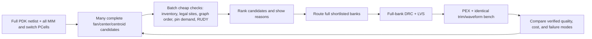

# Full-bank placement and routability papers

Read and checked on 2026-11-14 after the engineer corrected the four-MIM
coupon presentation. The complete one-stage fan placements already exist in
saved native-Mac GDS; the four-MIM cell was only an isolated routing coupon.

## Present physical evidence

| PDK | Core | Trim MIMs by bits 0–8 | Base MIM | Dummy MIMs | Switch MOS | PCell instances |
| --- | --- | --- | ---: | ---: | ---: | ---: |
| SKY130A | 4 × 21 | 8, 4, 2, 1, 2, 4, 8, 16, 32 | 1 | 61 | 20 | 159 |
| GF180MCU D | 4 × 17 | 16, 8, 4, 2, 1, 2, 4, 8, 16 | 1 | 53 | 20 | 135 |

Both verified fan snapshots use a uniform 14 µm MIM site grid and passed
Magic and native KLayout **placement DRC with zero findings**. Each of the
nine bit groups is side-adjacent and has a switch-facing entry in the bottom
row. The dummy PCells fill every remaining grid site, including the outer
ring. The verified [SKY GDS](/Users/auslyn/Developer/Microelectronic-layout/runs/rco/bank_placement/sky130/fan/9479ac4e-848c-45df-87d1-bc0e3638624e/rco_bank_placement.gds)
and [GF GDS](/Users/auslyn/Developer/Microelectronic-layout/runs/rco/bank_placement/gf180/fan/6d934442-bb96-433b-9759-3fadf49b137b/rco_bank_placement.gds)
are displayed at the top of the [floorplan page](http://127.0.0.1:8765/floorplans/),
with a button to open each complete bank in KLayout. The corresponding
`placement.json` and `report.json` files hold names, coordinates, counts,
hashes, and DRC evidence. The capacitor and switch nets are **not routed**;
dummy ground ties, bank LVS, PEX, and oscillator frequency remain open.

## RouteNet, ICCAD 2018: what the paper actually did

[Original RouteNet paper](https://research.nvidia.com/sites/default/files/pubs/2018-11_RouteNet%3A-routability-prediction/a80-xie.pdf)
defines two separate tasks:

1. **Early overall routability ranking:** Make image channels from macro
   occupancy, global long-range RUDY, and RUDY-weighted pin demand. Resize
   to 224 × 224 × 3, fine-tune a pretrained ResNet18, and estimate a
   four-level detailed-route DRC-violation class. This pass does **not** need
   a global route at inference time.
2. **Local DRC hotspot prediction:** Use a fully convolutional model that
   outputs a grid map. This later pass includes global-routing congestion
   features; it is **not** entirely route-free.

RUDY distributes an estimated net wire demand over its bounding box. It is
a spatial proxy, not a legal MIM route or an RC extraction. The authors used
five ISPD2015 digital designs of roughly 30,000–150,000 cells and 300–600
placements per design. Detailed-route DRC labels came from Cadence Encounter;
they held out each whole design in turn when evaluating prediction. Their
reported classification and hotspot results belong to that data and flow.
Our 61–77-unit analog bank, with **zero placement-only DRC findings and no
detailed-route labels**, cannot reproduce those numbers or train the same
target today.

## Circuit GNN, NeurIPS 2022: what can be reused

[Original Circuit GNN paper](https://proceedings.neurips.cc/paper_files/paper/2022/file/7fa548155f40c014372146be387c4f6a-Paper-Conference.pdf)
builds a heterogeneous **Circuit Graph** with cell vertices, net vertices,
pin/topology edges, and nearby-cell geometry edges. It bounds neighborhood
construction with shifted windows rather than testing every cell pair.
Separate topological and geometric messages are fused in the model. The
authors evaluated congestion using ISPD2011 with DREAMPlace placements and
NCTU-GR labels, and wirelength using DAC2012. This is a useful structural
template for our PDK MIMs, switches, nets, and site coordinates.

The [authors' code repository](https://github.com/PKUterran/NetlistGNN)
is available. Its README says raw data are not included, DREAMPlace output
must be prepared, and the first processed graph build may take about an hour.
Reproducing the **digital benchmark** is possible in principle with those
datasets and tool versions, but has not been run or validated on this Mac.
Applying the graph to this RCO requires a terminal-aware adapter: MIM
top/bottom plates, series order, transmission-gate pins, supply domains,
ground dummies, PDK geometry, and verified route/PEX labels. A cell-near-cell
edge must never be mistaken for an electrical connection.

## Faster lab method: full candidates, staged evidence

The previous route-four-then-check pattern is too narrow for evaluating a
nine-bit bank. The full one-stage bank is now the **unit of comparison**.

The floorplan page shows the stage status. Stage 1, complete PCell placement,
is done. Stage 2 is to construct full-bank feature maps and obtain meaningful
route-derived labels. Stage 3 is a rule/RUDY baseline followed by an adapted
RouteNet or Circuit GNN predictor. Stage 4 compares predicted rankings with
DRC/LVS/PEX and waveform results. We will not call a model "trained" because
it can run code or because all placement-only DRC counts are zero.

**Progress visibility:** Each batch gets a named stage, input and output
artifact hashes, candidate count, elapsed time, and an explicit pass/fail
condition. We show the current stage in the dashboard and report only a
meaningful stage change during long runs. The engineer can review the whole
placement and routing hypothesis before costly verification starts.
